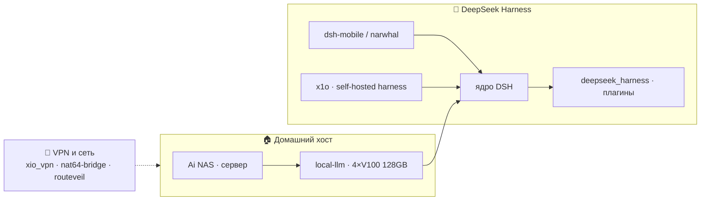

  

# Привет, я rukazax 👋

**RU** · [English](#english)

> Разработка под ключ: **сайты, мобильные приложения, расширения, VPN и AI**.
> Философия: своё железо, свои серверы, свои модели — приватность по умолчанию.

Здесь собраны все мои проекты: экосистема вокруг [DeepSeek Harness](https://github.com/rukazax/deepseek_harness) (агентская автоматизация), Android-клиенты, сетевые инструменты, домашний AI-NAS на 4×Tesla V100 и океанский кайт-солнечный катамаран ECONA.

## 🧭 Навигация

| Раздел | Кол-во |
| --- | --- |
| [🤖 AI, DSH и локальный ИИ](#-ai-dsh-и-локальный-ии) | 6 |
| [📱 Android и клиенты](#-android-и-клиенты) | 3 |
| [🔐 VPN и сеть](#-vpn-и-сеть) | 3 |
| [🧰 Утилиты](#-утилиты) | 2 |
| [⛵ ECONA](#-econa) | 3 |
| [🌐 Сайт и блог](#-сайт-и-блог) | 1 |
| [🔒 Приватные и архивы](#-приватные-и-архивы) | 2 |

> 🔒 = приватный репозиторий: ссылка откроется только мне (для посторонних — 404). В таблицах они перечислены для полноты карты проектов.

## Как всё связано

## 🤖 AI, DSH и локальный ИИ

| Репозиторий | Что это | Стек |
| --- | --- | --- |
| [local-llm](https://github.com/rukazax/local-llm) | Локальный LLM-сервер на 4×Tesla V100 SXM2 (128 ГБ NVLink): железо, движки, модели, роадмап | docs · CUDA · llama.cpp |
| [deepseek_harness](https://github.com/rukazax/deepseek_harness) | Плагины для DeepSeek Harness: MCP-клиент + Sarex и Яндекс.Почта MCP-серверы | Node.js · Python |
| [dsh-mobile](https://github.com/rukazax/dsh-mobile) | Мобильный пульт для DSH: плагин, PWA, WebView APK, руководство | JavaScript · Kotlin |
| [narwhal](https://github.com/rukazax/narwhal) | Неофициальный мобильный клиент DeepSeek Harness для Android | Flutter · Dart |
| [dsh-ddns](https://github.com/rukazax/dsh-ddns) | DDNS-обновлялка адреса (GitHub Actions + DuckDNS) для DSH | PowerShell |
| [x1o](https://github.com/rukazax/x1o) 🔒 | Самохостная платформа ИИ-ассистентов: единый API, очередь диалогов, биллинг | Python |

## 📱 Android и клиенты

| Репозиторий | Что это | Стек |
| --- | --- | --- |
| [ai-nas](https://github.com/rukazax/ai-nas) | Android-клиент домашнего NAS: SMART-дашборд, файл-менеджер SFTP·SMB·WebDAV, галерея, синхронизация папок, noVNC | Kotlin · Compose |
| [zcode-fold](https://github.com/rukazax/zcode-fold) | Складной Android-клиент ZCode 3.17: живой чат с агентом, проекты, файлы ПК — сопряжение по QR | Flutter · Dart |
| [briar_plus](https://github.com/rukazax/briar_plus) | Форк Briar: приватные голосовые P2P-звонки, конференции, форумы, биометрия (0.2.0-alpha) | Java · Android |

## 🔐 VPN и сеть

| Репозиторий | Что это | Стек |
| --- | --- | --- |
| [xio_vpn](https://github.com/rukazax/xio_vpn) | Свой VPN на своих серверах: Android, Ubuntu, Windows — один интерфейс | Flutter · AmneziaWG · Xray |
| [nat64-bridge](https://github.com/rukazax/nat64-bridge) | IPv4-сервисы на IPv6-only сервере через NAT64: REDIRECT → SO_ORIGINAL_DST → IPv6 dial | Go · Shell · iptables |
| [routeveil-android](https://github.com/rukazax/routeveil-android) | Экспериментальный Tor-роутинг на Android: явное раздельное туннелирование, приватная диагностика | Android · Kotlin |

## 🧰 Утилиты

| Репозиторий | Что это | Стек |
| --- | --- | --- |
| [Private_SpeedDial](https://github.com/rukazax/Private_SpeedDial) | Закладки и заметки для Chrome и Android с синхронизацией через своё облако | JavaScript |
| [z-code](https://github.com/rukazax/z-code) | Плагины ZCode: русская локализация интерфейса, установка с бэкапом и откатом | JavaScript · PowerShell |

## ⛵ ECONA

| Репозиторий | Что это | Стек |
| --- | --- | --- |
| [econa](https://github.com/rukazax/econa) | Океанский кайт-солнечный катамаран 13,6 м: публичный сайт и инженерная документация | HTML |
| [econa-project-private-archive-20261027](https://github.com/rukazax/econa-project-private-archive-20261027) 🔒 | Зеркало инженерного проекта: документация, расчёты, скрипты | Python · FreeCAD · OpenFOAM |
| [econa-private-archive-20261027](https://github.com/rukazax/econa-private-archive-20261027) 🔒 | Инженерная база знаний ECONA (сайт), приватная копия | HTML |

## 🌐 Сайт и блог

| Репозиторий | Что это | Ссылка |
| --- | --- | --- |
| [rukazax.github.io](https://github.com/rukazax/rukazax.github.io) | Сайт и блог: разработка под ключ, страницы продуктов, статьи | [rukazax.github.io](https://rukazax.github.io/) |

## 🔒 Приватные и архивы

| Репозиторий | Что это | Статус |
| --- | --- | --- |
| [ZVNO](https://github.com/rukazax/ZVNO) 🔒 | Безопасная платформа совместной работы: E2EE-медиа, relay, общая доска, протоколы встреч, лицензирование | в разработке |
| [dsh-mobile-archive-private](https://github.com/rukazax/dsh-mobile-archive-private) 🔒 | Архивный приватный снапшот dsh-mobile (история с локальными путями) | архив → см. dsh-mobile |

## 📊 Проекты в цифрах

- **20 проектных репозиториев**: 15 публичных + 5 приватных (счётчик `public repos` в бейджах живой и считает вместе с этим профиль-репозиторием; `private` — снапшот 19.11.2026)
- Языки: JavaScript ×5 · HTML ×4 · Dart ×3 · Python ×2 · Kotlin ×1 · Java ×1 · Shell ×1 · PowerShell ×1 · docs ×1 (остальное — разметка и конфиги)
- Ключевые направления: агентская автоматизация (DSH) · self-hosting · приватность · мобильные клиенты

## 📬 Как связаться

- ✉️ [rukazax@gmail.com](mailto:rukazax@gmail.com)
- 📱 +7 (999) 802-40-40
- 🌐 [rukazax.github.io](https://rukazax.github.io/)

---

## English

**[RU](#привет-я-rukazax-) · EN**

> Custom development to order: **websites, mobile apps, extensions, VPN and AI**.
> Philosophy: your own hardware, your own servers, your own models — privacy by default.

All of my projects live here: the ecosystem around [DeepSeek Harness](https://github.com/rukazax/deepseek_harness) (agent automation), Android clients, network tooling, a home AI-NAS on 4×Tesla V100, and the ECONA ocean kite-solar catamaran.

> 🔒 = private repository: the link opens only for me (404 for everyone else). They are listed for completeness of the project map.

### 🤖 AI, DSH and local LLM

| Repository | What it is | Stack |
| --- | --- | --- |
| [local-llm](https://github.com/rukazax/local-llm) | Local LLM server on 4×Tesla V100 SXM2 (128 GB NVLink): hardware, engines, models, roadmap | docs · CUDA · llama.cpp |
| [deepseek_harness](https://github.com/rukazax/deepseek_harness) | DeepSeek Harness plugins: MCP client + Sarex and Yandex Mail MCP servers | Node.js · Python |
| [dsh-mobile](https://github.com/rukazax/dsh-mobile) | Mobile remote control for DSH: plugin, PWA, WebView APK, manual | JavaScript · Kotlin |
| [narwhal](https://github.com/rukazax/narwhal) | Unofficial DeepSeek Harness mobile client for Android | Flutter · Dart |
| [dsh-ddns](https://github.com/rukazax/dsh-ddns) | DDNS updater (GitHub Actions + DuckDNS) for DSH | PowerShell |
| [x1o](https://github.com/rukazax/x1o) 🔒 | Self-hosted AI assistant platform: unified API, dialogue queue, billing | Python |

### 📱 Android and clients

| Repository | What it is | Stack |
| --- | --- | --- |
| [ai-nas](https://github.com/rukazax/ai-nas) | Android client for a home NAS: SMART dashboard, SFTP·SMB·WebDAV file manager, gallery, folder sync, noVNC | Kotlin · Compose |
| [zcode-fold](https://github.com/rukazax/zcode-fold) | Foldable Android client for ZCode 3.17: live agent chat, desktop projects/files — QR pairing | Flutter · Dart |
| [briar_plus](https://github.com/rukazax/briar_plus) | Briar fork: private P2P voice calls, conferences, forums, biometric unlock (0.2.0-alpha) | Java · Android |

### 🔐 VPN and network

| Repository | What it is | Stack |
| --- | --- | --- |
| [xio_vpn](https://github.com/rukazax/xio_vpn) | Your VPN, your servers: Android, Ubuntu, Windows — one interface | Flutter · AmneziaWG · Xray |
| [nat64-bridge](https://github.com/rukazax/nat64-bridge) | IPv4 services on an IPv6-only server via NAT64: REDIRECT → SO_ORIGINAL_DST → IPv6 dial | Go · Shell · iptables |
| [routeveil-android](https://github.com/rukazax/routeveil-android) | Experimental Android Tor routing: explicit split tunneling, privacy-preserving diagnostics | Android · Kotlin |

### 🧰 Utilities

| Repository | What it is | Stack |
| --- | --- | --- |
| [Private_SpeedDial](https://github.com/rukazax/Private_SpeedDial) | Bookmarks & notes for Chrome and Android, synced through your own cloud | JavaScript |
| [z-code](https://github.com/rukazax/z-code) | ZCode plugins: Russian UI localization with backup/rollback install | JavaScript · PowerShell |

### ⛵ ECONA

| Repository | What it is | Stack |
| --- | --- | --- |
| [econa](https://github.com/rukazax/econa) | 13.6 m ocean kite-solar catamaran: public site and engineering docs | HTML |
| [econa-project-private-archive-20261027](https://github.com/rukazax/econa-project-private-archive-20261027) 🔒 | Engineering project mirror: docs, calculations, scripts | Python · FreeCAD · OpenFOAM |
| [econa-private-archive-20261027](https://github.com/rukazax/econa-private-archive-20261027) 🔒 | ECONA engineering knowledge base (site), private copy | HTML |

### 🌐 Website and blog

| Repository | What it is | Link |
| --- | --- | --- |
| [rukazax.github.io](https://github.com/rukazax/rukazax.github.io) | Website & blog: custom development, product pages, articles | [rukazax.github.io](https://rukazax.github.io/) |

### 🔒 Private and archives

| Repository | What it is | Status |
| --- | --- | --- |
| [ZVNO](https://github.com/rukazax/ZVNO) 🔒 | Secure collaboration platform: E2EE media, relay, shared whiteboard, meeting minutes, licensing | in development |
| [dsh-mobile-archive-private](https://github.com/rukazax/dsh-mobile-archive-private) 🔒 | Archived private snapshot of dsh-mobile (original history with local paths) | archived → see dsh-mobile |

### 📊 Projects in numbers

- **20 project repositories**: 15 public + 5 private (the `public repos` badge is a live counter and includes this profile repo; `private` is a snapshot of 2026-11-19)
- Languages: JavaScript ×5 · HTML ×4 · Dart ×3 · Python ×2 · Kotlin ×1 · Java ×1 · Shell ×1 · PowerShell ×1 · docs ×1
- Focus areas: agent automation (DSH) · self-hosting · privacy · mobile clients

### 📬 Contact

- ✉️ [rukazax@gmail.com](mailto:rukazax@gmail.com)
- 📱 +7 (999) 802-40-40
- 🌐 [rukazax.github.io](https://rukazax.github.io/)

---

#ai #self-hosting #vpn #android #flutter #kotlin #deepseek-harness #mcp #nas #local-llm #econa #privacy
